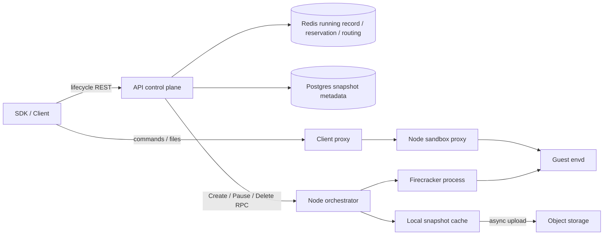

# E2B：为研究边界而做的源码分析

阅读日期：2026-09-07。范围：公开文档、infra 的生命周期关键路径、JavaScript SDK 对应调用、上游 Firecracker 快照规范。不是全仓安全审计，也没有对 E2B 云服务执行漏洞测试。

使用完成后的 Lean 性质回看 E2B 历史修复的结果，见[第一次 bug-finding 报告](e2b-bug-finding.md)。该报告已重现一个非原子路由删除反例，并将两项 E2B 历史竞态与 generation/effect 性质对应。

## 1. 版本与证据纪律

| 对象 | 本轮固定版本 | 用途 |
|---|---|---|
| E2B infra | `82f6529660ea98087d7a479247c789905b0a3867` | 分析实际后端逻辑 |
| E2B SDK | `473d8bf3e62b68ee731cf18afb2e8258f9ca7a7c` | 分析 SDK 与原始 API 之间的语义压缩 |
| Firecracker | v1.16.1，`2038188f145fb81b8d098147a10e9d9f392fd22f` | 本项目拟采用的单一后端与运行时契约 |

所有文件、行号、SHA256 和 GitHub 永久链接在[源码证据索引](../references/code-evidence.md)及[机器可读清单](../references/source-manifest.json)。本地源码放在 `research-sources/`，不作为本研究成果重新提交。

SDK 与 infra 分别取自当日可访问提交，不假定它们对应一个已部署的云端 release。真正复现实验还需锁定 SDK 依赖、API spec pin、envd、E2B Firecracker build、kernel、feature flags 和服务配置。本文不把当前公开仓库内容等同于 E2B 生产部署。

## 2. E2B 实际解决什么问题

E2B 向调用方暴露可执行命令、访问文件、保持进程/内存状态的 Linux 沙箱。SDK 负责方便地创建和连接沙箱，但真正的沙箱控制跨越多个服务。其核心执行隔离是 **Firecracker microVM**，模板构建会使用 OCI/Docker 镜像；不能据此认为下游只是 Docker 容器。[E01](../references/code-evidence.md)



图只保留本研究相关组件，省略模板构建、监控、volume、企业服务等。关键事实是 **exec 不经过生命周期 REST API 才到 guest**；控制面状态与数据面执行可能暂时不同步。[E01、E17、E22](../references/code-evidence.md)

## 3. “E2B 的状态机”不是一个 enum

infra 的 `sandboxtypes/states.go` 中，运行记录有 `running`、`pausing`、`killing`、`snapshotting`。它不是公开生命周期的全部表示：暂停对象通过持久化快照路径找到，创建/恢复还有 reservation 和 build 记录。不能看到没有 `StatePaused` 就断定 E2B 没建模暂停。[E02、E06–E10](../references/code-evidence.md)

源码已有的保护包括：

| 机制 | 已观察到的实现 | 它解决什么；仍不自动解决什么 |
|---|---|---|
| `ExecutionID` | removal 可带 `ExpectExecutionID`；Lua 在写点检查 | 避免旧扫描结果作用于新执行代；不自动覆盖所有外部副作用 |
| `LifecycleID` | 每个 FC 进程不同，live map 删除核对、连接池分组 | 避免某个旧进程的清理混到替换进程；不是所有权限的统一 version |
| 分布式锁 + transition ID | StartRemoving、完成结果键、通知/轮询 | 协调多个 API 请求及等待者；锁外工作与锁过期仍需按具体路径分析 |
| creation reservation | Lua 原子 reservation、配额、结果与等待 | 避免同时 start 的一些竞态；不能仅凭 reservation 宣称所有 create/kill 组合线性一致 |
| pause refusal restore | 按 flag 与错误类别恢复 running/route 或终止 | 保留可用性；回滚路径有自己的前置条件，不应建模为任何 pause 失败都回 Running |

证据：[E03–E06、E11、E15–E16](../references/code-evidence.md)。研究若只加一个 epoch/锁，会明显低估现有实现。

## 4. Create / Connect / Resume 调用链

`connect` 的处理器先尝试 KeepAlive；若 running 可直接返回，若正在某些转换中就等待，若不在 running store 中则转向快照恢复。`resume` 则对 already running、killing、snapshotting 等情况有独立分支。两者不能合并成无副作用的 `Get`。[E07–E08](../references/code-evidence.md)

`CreateSandbox` 在实际 placement 前申请 reservation，成功创建节点实例后再注册运行记录；若登记失败，源码有清理节点实例的路径。[E23–E24](../references/code-evidence.md) 这里已经暴露出研究需要的分解：

```
接收启动意图 → reservation → 节点创建/恢复 → 运行记录注册 → 对外返回
```

controller crash 或回复丢失可能发生在这些边界上。不能在抽象里把 `Create` 写成“先保证完全成功，再允许其它所有事件”，否则最有意义的竞态消失了。

E2B 的显式 resume 复用逻辑 sandbox ID，具体 Firecracker 进程另有 LifecycleID。用户凭证也不能想当然按实例失效：`GenerateEnvdAccessToken` 和 traffic token 的输入绑定 sid；“旧 SDK 句柄在 resume 后还能用”并不天然违反公开契约。[E15、E18](../references/code-evidence.md)

**范围结论**：本研究只保留显式 create/resume；关闭自动唤醒。内部 effect 的实例/操作身份必须检查，但不把所有历史 SDK 句柄失效当作目标。

## 5. Pause：数据库、冻结、缓存和持久化是多个事实

控制面路径大致是：

```
POST pause
  → RemoveSandbox / StartRemoving
  → 移除 routing 条目等节点删除准备
  → upsert snapshot/build metadata
  → orchestrator Pause RPC
  → 标记 build success / invalidate cache
  → 完成运行记录转换
```

节点路径可观察到：

```
snapshot admission 预检
  → MarkStopping
  → EnsurePausable
  → snapshotAndCacheSandbox
  → uploadSnapshotAsync
  → Pause RPC 返回；旧 sandbox 后台停止
```

源码有去重/封存等待、内存/磁盘快照路径及失败处理。上传任务脱离请求 context，并在后台重试；优雅关闭会等待上传，不等于任意节点掉电后都能保住本地未落盘内容。[E10–E14](../references/code-evidence.md)

这不是“异步上传所以一定丢数据”的漏洞证明：本地缓存、远端读取等待、peer 分发与具体故障域可能让设计成立。我们需要核对 **pause 返回承诺的故障语义**，然后实测相应故障点。

本项目首版有意选更简单的严格完成条件：全量 bundle 本地持久化 + 旧实例退出才 PauseCompleted；先承担延迟开销，等正确性链建立后再讨论弱化为异步持久化。若要证明 E2B 原样的异步上传协议，必须额外引入 `locally resumable` 与 `remotely durable` 两级状态，那是后续独立扩展。

## 6. Kill：逻辑撤销、物理停止与存储清理

REST kill 先走运行实例删除，再处理暂停快照的删除；两者不是一个统一存储事务。节点 Delete 将实例从 live 查询中标记为 stopping，再在 goroutine 中调用 Stop，RPC 不等待整个清理过程。[E09、E12](../references/code-evidence.md)

实际 Stop 包括 Firecracker 终止、cgroup kill、等待进程退出以及内存侧停止。另有 lifecycle cleanup 和连接池清理。因此至少存在三类观测：新流量是否还能路由、已有工作是否还在执行、后台资源是否全部释放。[E12、E17、E19](../references/code-evidence.md)

**不能直接作出的结论**：

- kill 后收到 stdout 不能证明新代码在 kill 后启动；可能是之前执行结果的传输延迟。
- kill 返回后 OS 尚有退出中进程不能自动证明新的 admission 仍然可行。
- SQL/Redis 清除也不能单独证明没有 orphan VM。

**范围结论**：把 `KillAccepted / RevokeBarrier / DestroyCompleted` 分开，测量各自延迟。E2B 对照先采用其可支持的可观察承诺，不用我们的强完成语义硬套。

## 7. Exec 与 SDK 语义压缩

JavaScript `commands.run` 的底层 start 是 envd 的 process RPC，并把启动事件转换为进程句柄；它不只是一次 REST sandbox 状态转换。SDK 中 `pause()` 把 409 转为 false，kill 将 404 转为 false。[E20–E22](../references/code-evidence.md)

实验不能只保存 `true/false`：必须同时保存原始 HTTP/gRPC status、body、invocation/response 时刻、sandbox ID、操作标识和测试阶段。并发 pause 的 409、已暂停的 409、超时无响应都可能需要不同解释。

公开文档还明确存在 [auto-resume](https://docs.e2b.dev/sandbox/auto-resume)：请求可以唤醒 paused sandbox。测试时若没有记录配置，“paused → 访问成功”根本不是可信反例。

## 8. 下游为什么选 Firecracker，不选 Docker

| 候选 | 对本问题的适合程度 | 首版决策 |
|---|---|---|
| Docker/runc 普通 pause/unpause | 能研究冻结，但不能自然代表 E2B 的持久化内存快照与新 microVM 恢复；再加入 CRIU 会扩大兼容性问题 | 不选 |
| containerd/Kata 多组件运行时 | 能覆盖更多部署，但证明边界和实现 adapter 显著增多 | 不选 |
| 上游 Firecracker 固定版本 + 全量快照 | 保留暂停、恢复点、实例替换的核心语义，API 面较小 | 选 v1.16.1 |

Firecracker 的 `LoadSnapshot` 可将新实例保持 Paused，之后再 Resume；这是实现“准备实例不等于授权执行”的合适分界。内存 backing file 需要不可变，磁盘文件由集成方负责，不能把 snapshot primitive 的成功扩张为完整 sandbox controller 的正确性。[F01–F04](../references/code-evidence.md)

## 9. 值得验证的假设，不是已发现的漏洞

| 假设 | 为什么值得测 | 要排除的正常解释 | 最小验证切面 |
|---|---|---|---|
| H1：kill 与已接受 resume 的迟到发布冲突 | start 与 running 注册、kill 与快照删除分步骤 | reservation、terminal/删除检查可能正确覆盖 | 在节点创建完成、API 注册之前阻塞，然后发 kill，观察恢复发布与最终状态 |
| H2：pause 成功与声明的持久化语义不一致 | 节点 upload 异步，元数据完成路径不同 | 本地/peer 可恢复、文档仅承诺较弱故障域 | 控制上传/本地存储故障，仅在匹配故障域下判定 |
| H3：旧清理作用于新实例 | 有 sandbox ID、ExecutionID、LifecycleID 多层身份 | 现有版本核对可能已阻止 | 延迟特定清理调用，再恢复新实例，检查精确目标 |
| H4：kill 后新 admission 仍可通过旧连接 | 控制面和连接池关闭不在同一瞬时 | 旧输出、已派发请求、SDK 重连/auto-resume | 捕捉可信入口派发事件和命令 nonce，而非只看 stdout 到达时间 |

本轮没有执行这些实验，不能给任何 H 标注“确认漏洞”。需要进一步阅读的路径包括精确的 edge RPC fencing、peer snapshot 可用性/读取等待、路由缓存失效与长连接转发。它们可能反驳上述假设，不能只寻找支持材料。

## 10. 分析对研究设计的直接约束

1. 从真实的交接边界抽象，不从一个 API 名字推断一条原子转移。
2. 区分逻辑 ID、执行代、物理进程和操作版本；以现有 E2B 防护作为比较基线。
3. 对 timeout 使用 Unknown，并把确定失败和不可知结果分开。
4. 把快照持久性作为 pause 完成条件的一部分，但明确故障域。
5. 同时验证回调处与副作用处，不能靠丢弃旧回调证明 VM 没被启动。
6. 不把 E2B 的所有功能塞进第一版；保留 pause/resume/kill 竞态，排除自动恢复、fork 和独立 snapshot。

这些约束导向[状态机设计](state-machine.md)与[实验协议](evaluation.md)，也构成后续审查规范是否合理的检查项。
