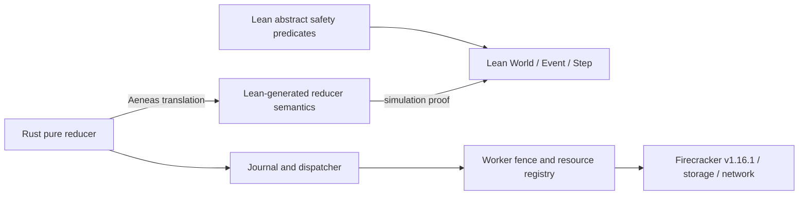

# Refinement：Lean 规范到 Rust controller 核心

状态：路线已确定；Lean 协议规范的完整 `Safe` 已证明，Rust/Aeneas 尚未开始。

## 1. 单一权威来源

Lean 中的 `World`、`Event`、`Step`、`Reachable` 和 `Safe` 是唯一 formal specification。项目不再维护 Python、TLA+ 或 Dafny 的并行规范，避免手工同步本身成为未证明的缺口。



当前只实现了图中的 A 与 P，并已证明 `Reachable world → Safe world`。按当前研究安排，暂不实现 reducer；下面保留的是后续 refinement 边界。

## 2. 最小 Rust reducer

目标接口：

```text
reduce(state, event) -> Result<(state', effects), Reject>
```

`state` 只包含协议需要持久化的当前记录；`event` 是已经通过外部解析和身份认证的值；`effects` 是带完整 sid/epoch/generation/resource identity 的命令描述。reducer 不打开文件、不访问网络、不调用 Firecracker、不读取 wall clock。

这样的边界让 reducer 保持确定、可翻译和可重放。controller runner 负责先提交 state，再派发 effects；失败和回执作为新 event 回到 reducer。

## 3. 模拟定理

设 `CState` 为 Rust reducer 经 Aeneas 翻译出的 Lean 状态，`R c w` 为它与协议 World 的关系。目标分三步：

```text
InitialC(c) ⇒ R(c, emptyWorld)

R(c, w) ∧ reduce(c, e) = Ok(c', effects)
⇒ ∃ w', Step w (observe e effects) w' ∧ R(c', w')

R(c, w) ∧ reduce(c, e) = Reject
⇒ 未产生任何未被规范允许的状态或 effect
```

内部日志重放、重复回执或明确无效事件可以对应 stutter，但对外发布 Running/Paused/Destroyed 和真实 worker effect 不能被随意隐藏成 stutter。

## 4. effect contract

每个 worker command 至少携带：

```text
(sid, epoch, terminal, generation, vm_id, slot_id, snapshot_id, payload_digest)
```

适用字段按命令种类出现。worker 在真正执行 load/activate/freeze/stop/network change 前重新核对当前 fence 与资源身份。controller 侧“回调过期所以忽略”不足以阻止已经发出的旧副作用。

InstallFence 的成功必须意味着：与更旧 epoch 冲突的副作用已经结束、被取消，或会在副作用点被拒绝。若 Firecracker 调用不可取消，worker 必须跟踪其实际结果，在确认 fence 前完成序列化或清理。

## 5. 持久化与派发顺序

runner 必须满足：

1. reducer 产生新 state 与 effects。
2. journal 原子持久新 state 和 operation 结果。
3. 提交确认后才派发 effects。
4. 提交后崩溃时，用同一 operation/epoch/generation 幂等重放。
5. effect 已发生但回执未持久时，保持 Unknown，查询精确资源或重放同一命令；不得新建替代 generation。

这部分不能全放进“adapter 正确”的一个大假设。至少要在 protocol model 中表示 outbox/ack discipline，并对安全关键 runner 代码给出 Aeneas 可处理的核心或单独的协议证明。

## 6. adapter 假设

| 边界 | 允许依赖的语义 |
|---|---|
| 身份认证 | event 中 actor/owner 是可信认证结果 |
| journal | 单机原子事务；确认后的记录在 controller crash/restart 后仍可读取 |
| worker fence | 当前 epoch/terminal 在副作用处核对；确认后旧冲突 effect 不会越过屏障 |
| FC prepare/load | 精确 VM identity，初始不执行 vCPU |
| FC activate | 成功可开始执行；timeout 可能已生效 |
| FC freeze | 成功表示精确 VM 的 vCPU 已暂停 |
| stop/wait | 返回确认时精确 VM 不再执行 |
| snapshot store | 同源 bundle 先写入，最后原子提交 immutable manifest；Durable 属于声明故障域 |
| workspace restore | `restore(manifest, workspace)` 成功时忠实恢复 manifest 指定的数据，以及下游承诺保留的内容、mode、owner、ACL 元数据 |
| network slot | 独占绑定 sid/generation/VM；configured 后才能 active；fence 可关闭 active |

Lean 证明 controller 传给 adapter 的 snapshot 来源、workspace、generation 和当前 `readWrite` policy 身份正确。底层 KVM、Firecracker、文件系统与编译器正确性不在证明内部；特别是 ext4/Linux 是否忠实保存内容和权限元数据，只能由固定版本、实现审计与故障实验支持上述契约。

## 7. Aeneas 使用约束

- Rust 只使用 Aeneas 当前可稳定翻译的安全子集。
- 数据结构围绕 reducer 需要设计，不追求通用 controller framework。
- unsafe、线程、socket、文件 I/O 和异步 runtime 留在 adapter 外层。
- 翻译产物可以生成，但关键 theorem 与 relation 保持手写、可读。
- 固定 Rust、Aeneas、Lean 版本和生成物 hash；Aeneas 与编译链列入 TCB。

若某个结构为了 Aeneas 需要大幅扭曲协议，优先缩小 reducer，而不是在 Lean 里另写一个“看起来相同”的手工 Rust 模型。

## 8. 完成定义

本项目只有同时满足以下条件，才称为 verified controller core：

- Lean 的完整 `Safe` 对任意可达 World 成立；
- Rust reducer 的每个成功分支模拟一个合法 Step；
- effect identity 与 commit-before-dispatch discipline 进入证明范围；
- adapter 假设逐项列明，并有对应的故障注入证据；
- 正常 create→pause→resume→kill 可达，避免退化成拒绝所有操作。

当前准确名称是“fully proved Lean protocol safety model”。只有上述实现、simulation 和 adapter 条件也完成后，才能称为 verified controller core。
