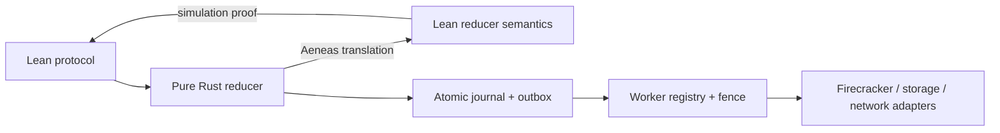

# Refinement：Lean 规范到 controller 与 adapter

状态：Lean 抽象协议的 safety 已证明；controller、worker 和 Firecracker adapter 尚未实现或证明。

## 1. 单一规范来源

Lean 中的 `World`、`Event`、`Step`、`Reachable` 与安全定理是唯一 formal specification。项目不维护 Python、TLA+ 或 Dafny 的第二份状态机。



当前只完成左侧的抽象协议。后续实现必须证明或测试每一条边界，不能因为抽象模型安全就称真实系统已经验证。

## 2. reducer 边界

目标接口：

```text
reduce(state, event) -> Result<(state', effects), Reject>
```

reducer 只决定持久状态和带完整身份的 effect，不访问文件、网络、Firecracker 或 wall clock。其状态至少包含 sandbox 记录、operation ledger、effect ledger、资源注册表、worker fence、policy receipt 与 snapshot manifest 引用。

成功分支的 refinement 目标是：

```text
R(c, w) ∧ reduce(c, e) = Ok(c', effects)
⇒ ∃ w', Step w (observe(e, effects)) w' ∧ R(c', w')
```

Reject 分支必须不产生未持久副作用。重复日志、query 和明确迟到消息可以对应 stutter；Running/Paused/Destroyed 的发布与真实 worker 动作必须对应具体 `Step`。

## 3. operation 与 outbox 事务

一次 controller 决策需要原子提交：

1. sandbox 新状态；
2. `(sid, operationId)` 账本更新；
3. 新 effect 的 committed outbox 记录。

提交确认后 dispatcher 才能把 effect 改成 dispatched 并发送。controller 在提交后崩溃，可以用同一个 EffectId 重放；不能另造 generation 或资源。worker 回执必须携带精确 EffectId 和结果摘要，controller 只能从该 effect 的 dispatched 记录接受 ack。

数学模型让 `EffectId` 直接包含完整 `Command`，因此无碰撞。实现需要确定性编码，并将编码字段至少覆盖适用的：

```text
sid, epoch, terminal, generation, effect kind,
vm_id, slot_id, snapshot/manifest, workspace, policy digest
```

## 4. adapter 合同

这些合同是模型与真实系统之间的窄接口：

| adapter | 成功返回必须表示 |
|---|---|
| journal | sandbox、operation 与 committed effects 已原子持久；重启后可读 |
| dispatch | 只派发已 committed 的同一 EffectId；重复派发具有相同含义 |
| worker fence | 在副作用点核对 epoch/terminal；确认后更旧冲突动作不能越过 fence |
| prepare/load | 只创建指定 sid/generation/vmId，且初始不执行 vCPU |
| activate | 只启动指定 VM；成功后该 VM 可能执行；timeout 不能当作未执行 |
| freeze | 只冻结指定 VM；成功表示 vCPU 已暂停 |
| stop/wait | 只停止指定 VM；确认后它不再执行 |
| apply policy | `applyPolicy(P,S,G,W)` 成功表示 W 上实际策略忠实实现 P，并绑定 S/G |
| seal snapshot | 产物绑定 sid、source generation、workspace 和 manifest；尚未承诺 durable |
| commit snapshot | 指定 manifest 已在声明故障域内 durable，之后身份不可变 |
| restore | `restore(M,W)` 成功表示 W 忠实恢复 M 描述的数据和承诺保留的权限元数据 |
| network slot | 只配置指定 sid/generation/vm/slot；inactive 后无新流量权 |
| cleanup VM | 只回收命令给出的 vmId，不按 sid 模糊删除 |
| cleanup slot | 只回收命令给出的 slotId，不影响当前 generation 的 slot |
| ack | 回执包含原 EffectId 和结果摘要，不能靠“当前 phase 看起来合理”匹配 |

`apply policy` 和 `restore` 合同包含 Linux 的真实语义，但 Lean 只证明传入的 `P/M/S/G/W` 身份正确。文件内容、mode、owner、ACL、路径解析、ext4、KVM 和内核正确性仍在 TCB/实验范围内。

## 5. fence 与不可取消动作

controller 忽略过期 callback 不能阻止已经发出的旧副作用。worker 必须在真正执行 prepare、activate、freeze、stop、policy、network 和 cleanup 之前重查 fence 与资源身份。

如果某个 Firecracker 调用不可取消，`InstallFence` 的成功语义必须明确：旧调用已经结束、已被序列化，或即使返回也会在提交资源状态前再次因身份检查被拒绝。这个语义需要 adapter 审计和 failpoint 实验支撑。

## 6. Aeneas 路线

- Rust 核心使用 Aeneas 可翻译的安全子集。
- 线程、socket、文件 I/O、异步 runtime 与 unsafe 留在 adapter 外层。
- 关键 relation 与 theorem 保持手写、可读；生成代码固定版本与 hash。
- 若通用框架让翻译困难，缩小 reducer，而不复制一份手写“相似模型”。
- Rust、Aeneas、Lean、编译器和 adapter 都如实列入 TCB。

## 7. 完成标准

只有以下工作都完成后，项目才能称为 verified controller core：

- Lean 对抽象协议的状态、准入和历史 safety 成立；
- Rust reducer 每个成功分支模拟合法 `Step`；
- operation/outbox 原子事务和 commit-before-dispatch 进入证明或窄 TCB；
- worker 对 effect/fence/resource 的检查有实现对应关系；
- adapter 合同逐条有固定版本审计与故障注入证据；
- 正常 create→pause→resume→kill 可完成，错误协议 mutant 会被测试识别。

当前完成的是第一项，所以准确表述仍是“fully proved Lean protocol safety model”。
