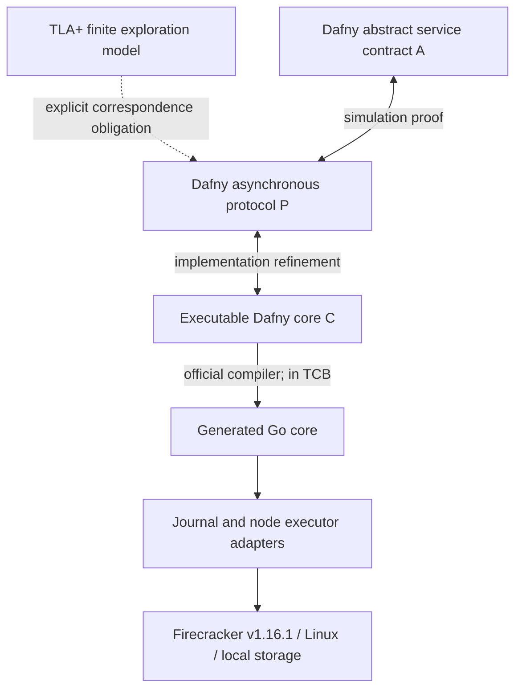

# Refinement 与 controller 生成：证明要跨过哪些边界

状态：证明计划，尚未产生机器检查的 refinement theorem。

## 1. 选择一条能闭合的路线

建议采用 `Dafny 可执行核心 → 官方 Go 编译后端 → 薄 runtime adapter`。研究对象是经验证的生命周期决策核心及其与执行器的协议，不自造通用语言或为任意运行时生成 controller。



箭头标的是应完成的义务，不表示本仓库已实现这些模块。TLA+ 是早期发现反例的辅助模型，不是编译源；最终证明依赖的 A/P 规范在 Dafny 中有明确声明。若保留独立 TLA+ 版本，必须把两份规范的对应关系列为独立待办，不能用测试替代形式化等价证明。

[Dafny 官方手册](https://dafny.org/dafny/DafnyRef/DafnyRef.html)说明了验证与多目标编译接口。本路线仍信任所选编译器与 Go 工具链；不宣称达到二进制级、内核级或 seL4 式完整证明。

## 2. 最小 controller 接口

决策核心应尽量是总函数，输入显式，避免把关键安全判断藏进异步 callback：

```text
Reduce(State, Event) -> (State', DurableWrites, Commands, Responses)
```

事件包括 Begin、FenceInstalled、LoadResult、ActivateResult、FreezeResult、SnapshotDurable、ProcessExited、Timeout、RecoverObservation。结果不仅有 success/error，也包括 outcome unknown 与“确定无副作用”的失败。

生成的 command 带 `(sid, owner, q, op_id, g, h, payload_digest)`。adapter 不可改变它的目标或参数；重试使用同一身份，禁止“重试时按 sandbox ID 重新找最新进程”。

**提交与派发纪律必须验证：** DurableWrites 的事务提交并确认后才能派发关联命令；若提交失败，命令不可发送。若提交成功但响应丢失，恢复重用原 op；若命令已发生但结果未持久化，恢复查询或幂等重放。不能让生成核心返回一个漂亮的状态机，而 hand-written runner 随意重排这些动作。

节点执行器处理 effect 时再次检查 fence，并在 per-sid 串行区内检查和发出 FC 操作。InstallFence 的成功回执要意味着先前冲突操作不可能在它之后产生未经纳入账本的副作用；若 FC 调用不可取消，必须等待或跟踪它的实际结果再确认屏障。

## 3. 分层证明义务

| 编号 | 应证明的命题 | 证明/验证材料 | 不能替代它的东西 |
|---|---|---|---|
| P0 | 初始状态良构，正常 create→pause→resume→kill 可完成 | 可达性与基础 lemma | 全部拒绝请求 |
| P1 | P 的每个动作保持身份、终止单调性、唯一执行、快照绑定 | 归纳不变量，逐动作 SMT/lemma | 只跑若干随机序列 |
| P2 | P 的可观察动作可模拟 A；内部动作只在允许时 stutter | 显式 R(P,A)、初始化与 step simulation | 状态 enum 名称相同 |
| P3 | 可执行 Reduce 满足 P 的 transition relation | executable method postconditions；结果分支齐全 | 从描述生成代码但不验证 |
| P4 | journal/runner/executor 不破坏命令顺序、身份、幂等与屏障 | 适配器协议模型及安全关键代码证明 | 把整个 runner 写成 `assume correct` |
| P5 | runtime 回执足以推出相应环境事实 | primitive 契约、适配器 lemma、实机 fault tests | controller 自己设置一个 bool |
| P6 | 最终稳定输入与公平/恢复假设下操作有结果 | 活性证明或清晰标注的有限活性检查 | 从 safety 推导 liveness |
| P7 | 生成实现遵守已验证核心语义 | 固定编译器、生成产物 hash、可重建 artifact；编译器明确列入 TCB | 手工翻译成 Rust 后靠单测称 refinement |

建议证明顺序：I3 终止单调性 → effect/callback 身份引理 → I1 执行唯一性 → I4 暂停完成 → trace refinement → 条件活性。若身份或屏障引理不能成立，应返回修改状态机，而不是在下游堆更多补偿代码。

## 4. 不可偷偷放进 TCB 的东西

以下属于本工作的关键逻辑，必须进入 P/实现证明或被明确报告为证明缺口：

- q、g、h 的分配/比较；terminal 的持久化与恢复。
- journal commit 和命令派发的先后关系。
- 旧事件是否可以发布 Running、恢复路由或覆盖快照 manifest。
- 节点在实际副作用发生处检查身份；屏障与不可取消操作的排序。
- 对未知结果的恢复决策；何时可以声明 Paused/Destroyed。
- GC/cleanup 的精确目标核对；不能误杀新 h。

可以作为环境假设、但需列清楚的底层部分：

| 假设 | 允许依赖的最低语义 | 不允许扩张成 |
|---|---|---|
| 身份认证 | 请求 owner 是可信认证结果 | 所有 snapshot 归属校验天然正确 |
| journal | 原子持久事务，已确认提交在所选崩溃模型下不丢 | 跨 journal 和 Firecracker 的全局原子性 |
| FC pause | 对精确 h 的确定成功表示 vCPU 已暂停 | 所有网络副作用与业务输出都已排空 |
| FC load | 关闭自动 resume 后得到 Prepared；输入文件须符合前提 | snapshot 的 owner 与当前执行资格已经验证 |
| FC resume | 成功可使 h 执行；通信超时可能已生效 | 超时一定无副作用 |
| stop/wait | 精确进程/子 cgroup 已停止并被确认 | 删除 routing 条目自动等于所有进程停止 |
| bundle durability | 同源、不可变文件与 manifest 在选定故障域内恢复 | 单个 snapshot API success 等于所有磁盘已持久 |
| 编译器/OS | 生成代码按语言语义运行，Linux/KVM primitive 满足契约 | 整个平台已经验证 |

不要让不可信 guest 自行报告的“我停下了”成为物理停止证明。guest 可辅助业务状态探针；虚拟机暂停/进程退出须从可信宿主边界确认。[Dafny 外部状态建模说明](https://github.com/dafny-lang/dafny/wiki/Modeling-External-State-Correctly)也提示了外部契约失真可能造成形式上通过、实际不成立的结论。

## 5. 崩溃一致性切面

| 崩溃发生位置 | 恢复必须做什么 |
|---|---|
| journal 提交前 | 不存在被承诺的新操作；不得已经派发副作用 |
| 提交后、dispatch 前 | 按原 op/q 幂等派发 |
| FC load/activate 后、回执前 | 查询精确 h，保持 Unknown 直到证据足够；不能再创建另一个 g 替代未知对象 |
| 快照文件完成、manifest 前 | 视为未提交恢复点；可校验补提或清理，不能谎报先前 pause 已完成 |
| terminal 提交后、worker fence 前 | 继续安装屏障并停止残余执行；拒绝新的 resume |
| worker fence 后、旧进程退出前 | 等待/重试精确终止；保持 Revoking |
| 完成记录提交后、客户端响应前 | 查询/幂等重试返回原结果；不能重新开始同一个操作 |

首轮有限模型只覆盖 controller crash。正式单节点实现还必须规定 executor crash：重启先恢复 fence/journal、封闭入口、扫描受管进程，识别或终止未能核实的实例，再对外 ready。若这条恢复链暂时未验证，论文必须限定 fault model 为 controller crash，不能笼统写成 crash-safe。

## 6. 研究工程规模预算

目标以工作量约束，而非预先承诺 LOC：先把 Reduce、执行器安全逻辑和 manifest 提交协议控制在能够逐方法审查的规模；网络服务、日志和性能优化尽量保持普通胶水代码。

单一后端、全量快照、无迁移、无独立 fork/snapshot、失败时保守终止，都用于缩小证明面。只有安全/精化结果成立后，才考虑让暂停后台上传、让旧实例保留、或增加自动唤醒。

如果最终只证明 Reduce，而关键 dispatch/fencing 部分仍是未验证的手写逻辑，结果只能称 **verified core under adapter assumptions**。这是可接受的阶段成果，但不能在标题或摘要中暗示完整 controller end-to-end verified。
