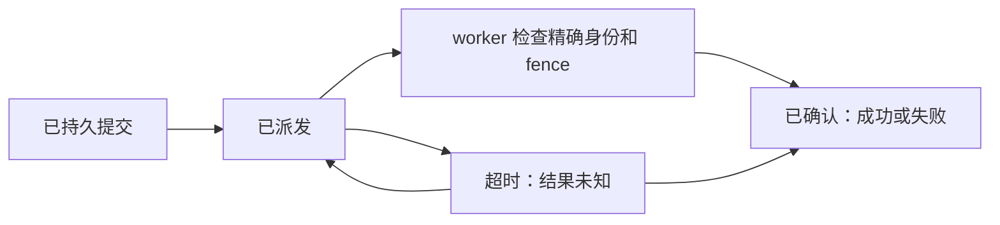

# 状态机与清晰边界

[文档目录](README.md) · [产品范围](project-blueprint.md) · [证明覆盖](proof-coverage.md)

本文解释既有协议模型，不重复定义产品 V1。模型包含暂停恢复，产品 V1 暂不启用；E2B 新接口、私有系统盘和真实执行合同仍需与模型连接，不能把它们视为已经验证。

研究方法是从 issue 与实现中提取重复的失败形态，再明确身份、状态、授权和失败语义，写成 Lean 的 `World → Step → World` 及安全定理。issue 是需求证据，不是自动成立的规范；实际 Rust 经 Charon/Aeneas 抽取后再证明对应。

这份状态机解决一个很具体的问题：沙箱暂停、恢复或销毁时，即使旧命令晚到、相同请求重发、controller 中途重启，也不能让旧实例重新获得权限，不能把错误的 workspace 或 snapshot 接到新实例上，也不能让旧清理任务误删当前资源。

它不是 Linux、Firecracker 或 E2B 的完整模型。它是 controller 与 worker 之间的安全协议。

## 1. 用门卡理解模型

可以把一个 sandbox 想成一间实验室：

- `SandboxId` 是房间号。
- `workspace` 是这间实验室专属的资料柜。
- `generation` 是门卡批次。每次 resume 都发行新批次，旧批次失效。
- `epoch` 是管理员最新命令的版本号。pause、resume、kill 都会提高它。
- `worker fence` 是门卫已执行到哪个版本的盖章。
- `effective authority` 是现在真正能开门的卡。
- `snapshot` 是资料与机器状态的封存包。它保存数据来源，不是一张门卡。

所以 resume 不是“从 snapshot 取出旧门卡”。它先选择一个合法封存包，再为新 generation 重新准备资源、应用 controller 当前保存的策略，最后签发新门卡。

## 2. 固定范围

既有模型的抽象范围：

- 单台 Linux/KVM 主机；
- 一个 controller、一个 worker；
- 底层虚拟机通过外部合同连接；实际版本组合由项目蓝图固定；
- 每个 sandbox 独占 workspace、VM 和网络槽；
- managed 文件 API 只有完整读写模式 `WorkspaceApiAccess.managedReadWrite`；
- 网络只有 `denyAll` 或静态 L3/L4 endpoint allowlist。

纳入 create、pause、resume、kill、managed exec/file/network 请求、operation 重试和查询、RPC timeout、controller crash/recover、effect 重复派发，以及旧 VM/slot 的延迟清理。

不纳入多节点迁移、共享卷、路径级 ACL、文件内容、UID/GID、POSIX ACL、host mount、symlink/hardlink 语义、DNS/SNI 动态策略、恶意宿主和资源计费。liveness 只在明确条件下纳入：调度不永久饿死、controller/journal 最终可用、已派发动作最终得到明确结果，以及 fence/stop/close 等安全收敛动作最终成功；不声称永久外部故障下也能完成。

## 3. 四层必须分开

| 层 | 模型里的对象 | 它回答的问题 |
|---|---|---|
| 受管 API 权限 | `WorkspaceApiAccess.managedReadWrite` 与 generation capability | 当前调用者能否提交受管文件读写请求？ |
| 下游权限策略 | `FilePolicyRef` | worker 应用的是不是 controller 当前指定的那一份策略？ |
| snapshot 数据身份 | `SnapshotManifestRef` | pause 封存和 resume 恢复的是不是同一份清单？ |
| Linux 实际行为 | adapter contract | chmod、owner、ACL、内容和文件系统恢复是否真的正确？ |

`FilePolicyRef` 和 `SnapshotManifestRef` 都是不透明摘要。Lean 只比较身份，不打开它们解释内部规则。这样能够证明“没有拿错策略或清单”，又不会把研究扩大成 Linux 文件系统验证。

## 4. World 保存什么

| 字段 | 含义 |
|---|---|
| `sandboxes` | owner、phase、terminal、epoch、generation、workspace、file policy、资源引用、authority、当前 operation |
| `vms` | VM 的 owner、sid、generation 与 prepared/executing/frozen/stopped/reclaimed 状态 |
| `filesystems` | workspace 的 owner、sid 与创建 generation |
| `snapshots` | owner、sid、来源 generation、workspace、manifest、durability 与 immutable 标志 |
| `netSlots` | owner、sid、generation、VM、网络策略及 configured/active/reclaimed 状态 |
| `appliedFilePolicies` | worker 最近成功应用的 sid、generation、workspace 与 policy |
| `workerFences` | worker 已安装的 `(epoch, terminal)` |
| `operations` | 以 `(sid, operationId)` 为键的输入、状态与最终结果账本 |
| `operationPlans` | 每个 operation 固定的 epoch、generation、VM、slot、恢复源、目标 snapshot、清理集合和重试上限；封存后不可换身份 |
| `resourceIndexes` | 每个 sandbox 的有限 VM/slot/snapshot 清单，供真实调度器枚举和执行全局关闭检查 |
| `logicalEffects` | 逻辑动作当前尝试编号、剩余重试次数、来源 operation 和最终结果 |
| `effectKeys` | 已知精确尝试的有限索引，供处理器扫描历史成功回执 |
| `effects` | 以“逻辑动作身份 + 尝试编号”为键的已提交、已派发、结果未知、已确认账本；确认项保存明确成功或失败 |
| `inflight` | 可重复、延迟、乱序出现的传输记录；它不授予执行资格 |
| `controllerUp` | controller 当前是否在线 |

`effects` 是持久权威。`inflight` 只表示消息可能再次出现。worker 步骤同时要求消息存在且对应 effect 已进入“已派发”或“结果未知”，因此一条没有持久提交的消息不能执行；超时后仍允许迟到执行，正是因为控制器不能假设未收到回执就等于没有执行。

有限的 `effectKeys` 不是未经证明的缓存：已经证明初始状态中它完整，并且每一种合法步骤都保持“`effects` 中的每个精确尝试都出现在清单里”。因此销毁和失败发布所做的有限扫描，能够覆盖权威账本中全部相关停止回执。

逻辑动作身份直接包含完整命令，包括适用的 sid、epoch、generation、资源 ID、workspace、policy 或 manifest 身份；精确 `EffectId` 再加上尝试编号。同一个逻辑动作可以有多次尝试，但不同尝试绝不会共用账本键。真实实现可用确定性编码加抗碰撞摘要，并把编码正确性列入 refinement。

## 5. 生命周期

```mermaid
stateDiagram-v2
    [*] --> Starting: create accepted
    Starting --> Running: resources + policy receipt + exact ack
    Running --> Pausing: pause accepted; epoch++
    Pausing --> Paused: fence + durable manifest + VM stopped
    Paused --> Starting: resume accepted; epoch++, generation++
    Starting --> Revoking: kill accepted
    Running --> Revoking: kill accepted
    Pausing --> Revoking: kill accepted
    Paused --> Revoking: kill accepted
    Revoking --> Destroyed: terminal fence + no execution/network
```



Running 的发布条件很严格：当前 VM 已 executing；当前 slot 已 configured 且没有旧 active slot；worker 已为精确的 `sid + generation + workspace + current filePolicy` 写入应用记录；对应 `applyFilePolicy` effect 已被精确确认；当前 operation 在持久账本中仍是未完成记录。发布动作才同时打开 exec、file 和 network authority，并写入稳定操作结果。

pause 接受时先关闭 controller 的 `desired` authority。worker 安装撤销 fence 后才关闭 `effective` authority和网络槽，所以模型保留真实的短暂撤销窗口。停止当前 VM 前，规范和可执行处理函数都要求使用本次暂停操作计划选定的目标 snapshot，不能拿同一代的另一份旧 snapshot 作为停机依据。Paused 只能在该 snapshot 已 durable/immutable、manifest 身份正确、该 sandbox 的所有 VM 都已 `stopped/reclaimed`、网络已关闭后发布。仅仅“没有 executing VM”不够：`prepared/frozen` 仍是需要收敛的活资源。

resume 只从 `durableSnapshot` 选择精确的 `RestoreSource(snapshot, manifest)`。新 generation 从关闭权限开始，之后重新应用 controller 当前 `filePolicy`。snapshot 本身没有 authority 字段，也不能绕过重新签发。

kill 接受时立即写入不可逆 `terminal = true`。资源可以随后异步停止和回收，但 Destroyed 只有在 terminal fence、所有 VM 已 `stopped/reclaimed`、无 active slot 后才能发布。因此发布操作清空 `currentVm` 后不会隐藏一个仍需 stop 的 VM。

create/resume/pause 的失败通过主状态机中的失败关闭补偿路径处理：原 operation 进入 `compensating(failure)`，sandbox 进入 terminal `revoking`，安装 terminal fence 并使资源收敛，最后以 `failed(failure)` 结果发布 Destroyed。pause 失败不尝试猜测部分冻结或部分快照之后还能否安全回滚到 Running，而是选择权限更保守的终止路径。这条路径是正式 `Event/Step/Reachable`，不是一个绕开主不变量的删除函数。资源、策略、存储等外部失败必须引用一条已经持久记录的失败回执，而且该命令的 `sid + epoch` 必须属于当前 operation；主动取消和 controller 自己的截止时间到期不依赖外部回执。

kill 若打断 Starting 或 Pausing 中的未完成 operation，会在写入新 kill operation 的同一个状态转移里，把旧 operation 记为 `failed(cancelled)` 并保存最终结果。terminal revocation 一旦开始，新的不同 operation ID 的 kill 会被拒绝；相同请求只能通过既有 operation 重试路径查询或重放。

## 6. Operation 与 effect 为什么要有两个账本

Operation 是用户看到的请求，例如“暂停 S”。Effect 是 controller 发给 worker 的具体动作，例如“冻结 generation 3 的 VM V”。一个 operation 通常会产生多个 effect。

Operation ledger 保证：

- 键是 `(SandboxId, OperationId)`；
- 相同 ID 的重试必须有相同 kind 和完整输入；
- 重试不会创建第二个生命周期决定；
- query 只返回已持久记录；
- 最终结果一旦存在，任何合法步骤都不能改变它；
- 失败不是异常旁路：status 包含 `compensating(failure)` / `failed(failure)`，result 包含 `failed(failure)`；
- create/resume 失败必须走 terminal fence 和资源收敛后才能完成，不允许原子删除跳过中间状态。

Effect ledger 的主要顺序是：



模型证明没有已提交记录就不能派发；超时不会伪造失败，只会把结果标为未知；结果未知的命令可以安全重发，迟到回执仍可接收。成功回执只有在对应命令的后置状态已经可见时才有效；当前模型把命令视为全成功或全失败，所以成功后置状态已存在时不能再接受失败回执。同一回执重复提交是不改变状态的重放，内容不同的回执会被拒绝。一个 effect 的确认不改变另一个 effect，已确认结果不会回退。

重试只发生在当前精确尝试已经得到明确失败、该失败被分类为可重试、仍有预算且下一个连续编号尚不存在时。新尝试恰好是 `currentAttempt + 1`，预算同时减少一次。超时、重发和结果未知不会创建新编号；不可重试失败或预算耗尽必须进入逻辑动作的最终失败。旧尝试的迟到或冲突回执按其原编号处理，不能覆盖当前尝试。

当前命令账本覆盖 fence、VM 准备、网络配置、VM 激活、文件策略、冻结、封存快照、提交快照、停止 VM，以及 VM/网络槽回收。稳定状态发布必须看到本阶段每个必要命令的成功确认，不能仅凭资源看起来已经变化就发布。

## 7. 旧资源清理

清理命令不是“删除 sandbox S”，而是：

```text
cleanupVm(sid, generation, vmId)
cleanupSlot(sid, generation, slotId)
```

worker 在删除点重新检查资源的 sid、generation、具体 ID、停止/关闭状态，并要求它不是当前记录引用的资源。Lean 直接证明 cleanup 只把这个精确资源改成 reclaimed，sandbox 表不变，步骤完成后该资源仍不是 current；`reachable_reclaimedResourcesNotCurrent` 进一步证明这个结论在任意长的合法历史中持续成立。场景证明还覆盖 generation 1 的清理延迟到 generation 2 已运行时，generation 2 的 VM 保持不变。

## 8. 已证明的合同

状态不变量由 `reachable_safe` 对任意可达 World 证明，包括资源归属、workspace 双向绑定、当前资源身份、单执行 VM、单活动 slot、snapshot 不可变、authority 形状、fence 合法、terminal 与稳定状态要求、恢复源及当前 operation 一致性。

`reachable_protocol_secure` 在此基础上加入合法 policy receipt、Running 的精确 policy receipt、operation ledger 身份、当前 operation 的账本存在性、effect identity，以及所有 reclaimed 资源都不是 current。其余跨历史性质以一步定理表达，因为它们本来就需要比较前后状态：

- `step_epochMonotone`
- `step_generationMonotone`
- `step_workerFenceMonotone`
- `step_never_clears_terminal`
- `step_workspaceIdentityStable`
- `step_workspaceApiAccessStable`
- `step_filePolicyStable`
- `step_snapshotManifestStable`
- `step_operationIdentityStable`
- `step_operationResultStable`
- `step_effectResultStable`
- `step_ackCannotChangeAnotherEffect`
- `acceptKill_finalizes_superseded`

`step_protocol_secure` 将状态保持、事件授权、文件/网络准入、effect 的 commit/dispatch/ack 准入、cleanup 的精确资源准入，以及所有单调与稳定性质汇总成一个 `ProtocolStepSecurity before event after` 合同，便于评审每个合法步骤。

准入和身份定理还覆盖 Running authority 精确绑定、非 Running 不接受新 managed file 请求、旧 generation 文件请求被拒绝、resume 重签权限、snapshot 不携带 authority、旧 file-policy 命令被拒绝、commit-before-dispatch、ack 精确匹配及 cleanup 精确寻址。

把历史性质保留为 `Step before event after` 定理是有意的：单个 `World` 无法单独表达“没有倒退”。顶层单状态结构没有假装包含这些历史结论。

## 9. Lean 证明到哪里为止

| Lean 已证明 | 仍需 refinement 或 adapter 证据 |
|---|---|
| 任意有限合法历史中的身份、代、权限和资源关系 | 生产二进制是否只通过已证明 reducer 改变状态 |
| 请求、effect、调度、worker 和发布的纯处理器有双向覆盖；现有 Rust 公开输入已有带容量前提的对应证明 | 新增持久化、服务、真实执行与恢复路径的实现对应 |
| 操作计划一旦封存，资源身份和清理范围不可更换；有限资源索引与全局资源条件一致 | 资源发现和 journal 事务是否忠实维护这些索引 |
| 明确进度合同与弱公平下，operation 最终并永久得到成功或失败结果 | VM/storage/network 最终响应，以及 fence/stop/close 安全收敛动作最终成功 |
| controller crash 不丢持久 operation/effect 记录 | journal 的原子性与断电持久性 |
| policy/manifest 的精确引用传递 | Linux 是否忠实应用策略并恢复内容、mode、owner、ACL |
| 当前 generation 才能获得 managed authority | 网关、worker 和 Firecracker adapter 是否执行相同检查 |
| fence、terminal、operation/effect 结果不倒退 | worker fence 的真实序列化和取消语义 |
| cleanup 只指向精确旧资源 | 实际 delete/stop API 是否只影响该 VM 或 slot |
| Paused/Destroyed 发布需要所有 VM 已 stop/reclaim 且无活动网络 | KVM、Firecracker、内核和网络栈的底层正确性 |

`Reachable` 覆盖任意有限步数，证明的是 safety：坏状态到不了。无限轨迹与公平性定理另行处理完成性。最终完成定理要求有限进度量持续下降，并明确要求适配器响应和安全清理能够收敛；它不保证永久故障后自动恢复。

`Controller.lean` 已给出请求准入、effect 派发/超时/回执/重试/最终失败、下一动作调度和稳定状态发布；`WorkerController.lean` 给出全部 worker 动作。每个接受结果都是合法 `Step` 且保持安全，对应的完备性模块证明规范允许且证据齐全的分支能够由处理函数产生。这仍是纯状态处理核心，不是已经部署的 controller 服务。

storage adapter 的关键假设是：

> `restore(manifest, workspace)` 成功时，恢复后的文件系统忠实实现该 manifest，包括下游承诺保存的内容和权限元数据。

policy adapter 的关键假设是：

> `applyPolicy(policy, sid, generation, workspace)` 成功时，目标 workspace 对该 sandbox generation 的实际 Linux 权限与 policy 所描述的配置一致。

Lean 验证这些调用携带正确身份及其成功回执；它不证明假设内部的 Linux 行为。

所有 adapter 还共享一个结果合同：在当前首版的全有或全无抽象中，`succeeded` 表示对应命令的建模后置状态已经成立，`failed` 表示该后置状态没有成立。若真实 adapter 可能“返回失败但已经产生部分或完整副作用”，就必须把该部分结果扩展成新的结构化 outcome 和补偿规则，不能把它隐藏在普通失败字符串里。
