# 状态机与清晰边界

这份状态机解决一个很具体的问题：沙箱暂停、恢复或销毁时，即使旧命令晚到、相同请求重发、controller 中途重启，也不能让旧实例重新获得权限，不能把错误的 workspace 或 snapshot 接到新实例上，也不能让旧清理任务误删当前资源。

它不是 Linux、Firecracker 或 E2B 的完整模型。它是 controller 与 worker 之间的安全协议。

## 1. 用门卡理解模型

可以把一个 sandbox 想成一间实验室：

- `SandboxId` 是房间号。
- `workspace` 是这间实验室专属的资料柜。
- `generation` 是门卡批次。每次 resume 都发行新批次，旧批次失效。
- `epoch` 是管理员最新命令的版本号。pause、resume、kill 都会提高它。
- `worker fence` 是门卫已执行到哪个版本的盖章。
- `effective authority` 是现在真正能开门的卡。
- `snapshot` 是资料与机器状态的封存包。它保存数据来源，不是一张门卡。

所以 resume 不是“从 snapshot 取出旧门卡”。它先选择一个合法封存包，再为新 generation 重新准备资源、应用 controller 当前保存的策略，最后签发新门卡。

## 2. 固定范围

首版固定：

- 单台 Linux/KVM 主机；
- 一个 controller、一个 worker；
- Firecracker v1.16.1；
- 每个 sandbox 独占 workspace、VM 和网络槽；
- managed 文件 API 只有完整读写模式 `WorkspaceApiAccess.managedReadWrite`；
- 网络只有 `denyAll` 或静态 L3/L4 endpoint allowlist。

纳入 create、pause、resume、kill、managed exec/file/network 请求、operation 重试和查询、RPC timeout、controller crash/recover、effect 重复派发，以及旧 VM/slot 的延迟清理。

不纳入多节点迁移、共享卷、路径级 ACL、文件内容、UID/GID、POSIX ACL、host mount、symlink/hardlink 语义、DNS/SNI 动态策略、恶意宿主、资源计费和 liveness。

## 3. 四层必须分开

| 层 | 模型里的对象 | 它回答的问题 |
|---|---|---|
| 受管 API 权限 | `WorkspaceApiAccess.managedReadWrite` 与 generation capability | 当前调用者能否提交受管文件读写请求？ |
| 下游权限策略 | `FilePolicyRef` | worker 应用的是不是 controller 当前指定的那一份策略？ |
| snapshot 数据身份 | `SnapshotManifestRef` | pause 封存和 resume 恢复的是不是同一份清单？ |
| Linux 实际行为 | adapter contract | chmod、owner、ACL、内容和文件系统恢复是否真的正确？ |

`FilePolicyRef` 和 `SnapshotManifestRef` 都是不透明摘要。Lean 只比较身份，不打开它们解释内部规则。这样能够证明“没有拿错策略或清单”，又不会把研究扩大成 Linux 文件系统验证。

## 4. World 保存什么

| 字段 | 含义 |
|---|---|
| `sandboxes` | owner、phase、terminal、epoch、generation、workspace、file policy、资源引用、authority、当前 operation |
| `vms` | VM 的 owner、sid、generation 与 prepared/executing/frozen/stopped/reclaimed 状态 |
| `filesystems` | workspace 的 owner、sid 与创建 generation |
| `snapshots` | owner、sid、来源 generation、workspace、manifest、durability 与 immutable 标志 |
| `netSlots` | owner、sid、generation、VM、网络策略及 configured/active/reclaimed 状态 |
| `appliedFilePolicies` | worker 最近成功应用的 sid、generation、workspace 与 policy |
| `workerFences` | worker 已安装的 `(epoch, terminal)` |
| `operations` | 以 `(sid, operationId)` 为键的输入、状态与最终结果账本 |
| `effects` | 以完整命令为确定性 ID 的 committed/dispatched/acknowledged 账本 |
| `inflight` | 可重复、延迟、乱序出现的传输记录；它不授予执行资格 |
| `controllerUp` | controller 当前是否在线 |

`effects` 是持久权威。`inflight` 只表示消息可能再次出现。worker 步骤同时要求消息存在且对应 effect 已进入 `dispatched`，因此一条没有持久提交的消息不能执行。

EffectId 在数学模型中直接包含完整命令，包括适用的 sid、epoch、generation、资源 ID、workspace、policy 或 manifest 身份。这比在规范里使用可能碰撞的哈希更清楚；真实实现可用确定性编码加抗碰撞摘要，并把编码正确性列入 refinement。

## 5. 生命周期

```mermaid
stateDiagram-v2
    [*] --> Starting: create accepted
    Starting --> Running: resources + policy receipt + exact ack
    Running --> Pausing: pause accepted; epoch++
    Pausing --> Paused: fence + durable manifest + VM stopped
    Paused --> Starting: resume accepted; epoch++, generation++
    Starting --> Revoking: kill accepted
    Running --> Revoking: kill accepted
    Pausing --> Revoking: kill accepted
    Paused --> Revoking: kill accepted
    Revoking --> Destroyed: terminal fence + no execution/network
```



Running 的发布条件很严格：当前 VM 已 executing；当前 slot 已 configured 且没有旧 active slot；worker 已为精确的 `sid + generation + workspace + current filePolicy` 写入应用记录；对应 `applyFilePolicy` effect 已被精确确认；当前 operation 在持久账本中仍是未完成记录。发布动作才同时打开 exec、file 和 network authority，并写入稳定操作结果。

pause 接受时先关闭 controller 的 `desired` authority。worker 安装撤销 fence 后才关闭 `effective` authority和网络槽，所以模型保留真实的短暂撤销窗口。Paused 只能在 snapshot 已 durable/immutable、manifest 身份正确、VM 已停止且网络已关闭后发布。

resume 只从 `durableSnapshot` 选择精确的 `RestoreSource(snapshot, manifest)`。新 generation 从关闭权限开始，之后重新应用 controller 当前 `filePolicy`。snapshot 本身没有 authority 字段，也不能绕过重新签发。

kill 接受时立即写入不可逆 `terminal = true`。资源可以随后异步停止和回收，但 Destroyed 只有在 terminal fence、无 executing VM、无 active slot后才能发布。

## 6. Operation 与 effect 为什么要有两个账本

Operation 是用户看到的请求，例如“暂停 S”。Effect 是 controller 发给 worker 的具体动作，例如“冻结 generation 3 的 VM V”。一个 operation 通常会产生多个 effect。

Operation ledger 保证：

- 键是 `(SandboxId, OperationId)`；
- 相同 ID 的重试必须有相同 kind 和完整输入；
- 重试不会创建第二个生命周期决定；
- query 只返回已持久记录；
- 最终结果一旦存在，任何合法步骤都不能改变它；
- `failed` 已从首版删除，因为当前协议没有定义失败补偿路径。

Effect ledger 的顺序是：


模型证明没有 committed 记录就不能 dispatch；ack 只能从精确 EffectId 的 dispatched 状态产生；一个 effect 的 ack 不改变另一个 effect；已确认结果不会回退；重复或迟到 delivery 是幂等 stutter。

## 7. 旧资源清理

清理命令不是“删除 sandbox S”，而是：

```text
cleanupVm(sid, epoch, generation, vmId)
cleanupSlot(sid, epoch, generation, slotId)
```

worker 在删除点重新检查资源的 sid、generation、具体 ID、停止/关闭状态，并要求它不是当前记录引用的资源。Lean 直接证明 cleanup 只把这个精确资源改成 reclaimed，sandbox 表不变，步骤完成后该资源仍不是 current；`reachable_reclaimedResourcesNotCurrent` 进一步证明这个结论在任意长的合法历史中持续成立。场景证明还覆盖 generation 1 的清理延迟到 generation 2 已运行时，generation 2 的 VM 保持不变。

## 8. 已证明的合同

状态不变量由 `reachable_safe` 对任意可达 World 证明，包括资源归属、workspace 双向绑定、当前资源身份、单执行 VM、单活动 slot、snapshot 不可变、authority 形状、fence 合法、terminal 与稳定状态要求、恢复源及当前 operation 一致性。

`reachable_protocol_secure` 在此基础上加入合法 policy receipt、Running 的精确 policy receipt、operation ledger 身份、当前 operation 的账本存在性、effect identity，以及所有 reclaimed 资源都不是 current。其余跨历史性质以一步定理表达，因为它们本来就需要比较前后状态：

- `step_epochMonotone`
- `step_generationMonotone`
- `step_workerFenceMonotone`
- `step_never_clears_terminal`
- `step_workspaceIdentityStable`
- `step_workspaceApiAccessStable`
- `step_filePolicyStable`
- `step_snapshotManifestStable`
- `step_operationIdentityStable`
- `step_operationResultStable`
- `step_effectResultStable`
- `step_ackCannotChangeAnotherEffect`

`step_protocol_secure` 将状态保持、事件授权、文件/网络准入、effect 的 commit/dispatch/ack 准入、cleanup 的精确资源准入，以及所有单调与稳定性质汇总成一个 `ProtocolStepSecurity before event after` 合同，便于评审每个合法步骤。

准入和身份定理还覆盖 Running authority 精确绑定、非 Running 不接受新 managed file 请求、旧 generation 文件请求被拒绝、resume 重签权限、snapshot 不携带 authority、旧 file-policy 命令被拒绝、commit-before-dispatch、ack 精确匹配及 cleanup 精确寻址。

把历史性质保留为 `Step before event after` 定理是有意的：单个 `World` 无法单独表达“没有倒退”。顶层单状态结构没有假装包含这些历史结论。

## 9. Lean 证明到哪里为止

| Lean 已证明 | 仍需 refinement 或 adapter 证据 |
|---|---|
| 任意有限合法历史中的身份、代、权限和资源关系 | controller/worker 实现的每个分支确实对应合法 `Step` |
| controller crash 不丢持久 operation/effect 记录 | journal 的原子性与断电持久性 |
| policy/manifest 的精确引用传递 | Linux 是否忠实应用策略并恢复内容、mode、owner、ACL |
| 当前 generation 才能获得 managed authority | 网关、worker 和 Firecracker adapter 是否执行相同检查 |
| fence、terminal、operation/effect 结果不倒退 | worker fence 的真实序列化和取消语义 |
| cleanup 只指向精确旧资源 | 实际 delete/stop API 是否只影响该 VM 或 slot |
| Paused/Destroyed 发布需要无执行与无活动网络 | KVM、Firecracker、内核和网络栈的底层正确性 |

`Reachable` 覆盖任意有限步数，证明的是 safety：坏状态到不了。它不保证请求最终完成，也不保证永久故障后自动恢复。

storage adapter 的关键假设是：

> `restore(manifest, workspace)` 成功时，恢复后的文件系统忠实实现该 manifest，包括下游承诺保存的内容和权限元数据。

policy adapter 的关键假设是：

> `applyPolicy(policy, sid, generation, workspace)` 成功时，目标 workspace 对该 sandbox generation 的实际 Linux 权限与 policy 所描述的配置一致。

Lean 验证这些调用携带正确身份及其成功回执；它不证明假设内部的 Linux 行为。
