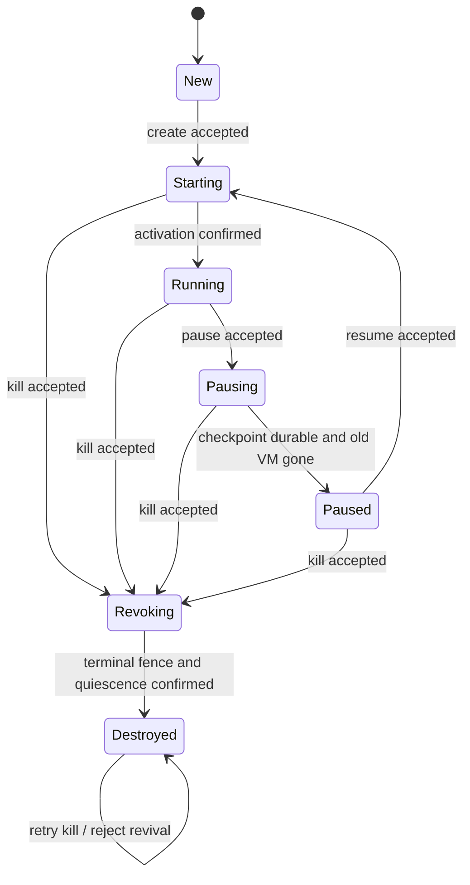

# 状态机：把执行权与恢复点分开

这是待证明的协议设计。文中的“必须”是本研究提出的契约，不意味着 E2B 已承诺或违反它。已有小模型只覆盖[第 10 节](#10-可执行小模型覆盖了什么)所列子集。

## 1. 起点：不能从一个 lifecycle enum 推出全系统事实

同一时刻，API 可以已经记录 `killing`，节点已经撤掉新请求路由，而旧 Firecracker 进程仍在退出。另一时刻，API 的 pause 已成功，但快照仍在从节点缓存上传。E2B 的这些动作确实分布在不同函数和执行阶段中。[E09–E14、E19](../references/code-evidence.md)

因此，以下三个等式都不能直接使用：

```
Redis 没有 running record = 物理 VM 不存在
Pause RPC 成功 = 所有快照文件已经在声明故障域内持久化
有合法快照 = 现在仍被允许恢复执行
```

建议中心原则：**恢复点携带计算状态；执行许可来自快照之外的、不可回滚的当前控制记录。** kill 不能靠删除一个瞬时缓存项实现终态，resume 不能靠“我之前读到过一个快照”获得永久许可。

## 2. 三层状态，不把抽象规范与实现搅在一起

### A：可观察服务契约

抽象对象有不可变 `sid, owner`，逻辑 phase、当前执行代 `g`、入口开闭 `admission`、已承诺恢复点 `checkpoint` 和不可逆终止标志 `terminal`。



这是正常流程投影，省略了失败、查询、自循环和 crash。`Starting` 同时服务于初次创建和暂停后的恢复；`Pausing` 表示一个未完成操作，不保证 guest 已冻结。`Revoking` 也不表示物理执行已经停止。

公开协议把 `Accepted(op)`、`Completed(op, result)`、`Rejected`、`OutcomeUnknown(op)` 分开。若暴露同步 API，只能在 Completed 后返回成功；客户端自行断开只能得到 OutcomeUnknown，服务端可以继续完成。

`PauseCompleted` 与 `DestroyCompleted` 是事件而非永恒状态断言：pause 成功之后另一个合法 resume 可以让 VM 再次运行。因此需要检查有序历史，不能拿很久之后的 `query()` 覆盖当时的判断。

### P：异步协议的乘积状态

不要为每一种组合发明一个 enum。建议正式模型使用以下记录，并用良构不变量限制可达组合：

| 字段 | 含义 | 持久/可信边界 |
|---|---|---|
| `sid, owner` | 不重用的逻辑沙箱身份、不可变所有者 | journal，身份认证结果来自可信层 |
| `intent ∈ {Run, Pause, Delete}` | 最近已提交的目标 | journal；Delete 为吸收态 |
| `q ∈ Nat` | 每个新生命周期操作的单调序号 | journal；重试同一 op 不增加；不可回绕 |
| `op = (id, q, kind, stage, result)` | 已接受操作及其进行/完成记录 | journal；幂等键绑定参数，不能以相同键改操作 |
| `g ∈ Nat` | 执行代；每次新分配运行实例递增 | journal；controller crash 不重置 |
| `h` | 具体 FC 进程的唯一身份 | 节点 registry，使用进程句柄/出生信息，不只用可复用 PID |
| `workerFence = (q_w, terminal_w)` | 执行器已安装的版本屏障 | 在实际副作用发生处核对；重启须恢复或拒绝服务 |
| `cap = Closed / Open(g,h)` | managed exec 的入口能力 | 节点执行器；路由缓存本身没有授权权威 |
| `snapshot = (id, sid, owner, source_g, build, stage)` | 当前恢复点的归属、内容绑定与提交状态 | stage 为 None/LocalSealed/Durable；manifest 不得回滚 terminal |
| `actual[h]` | Absent/Prepared/Frozen/Executing/Exited | 环境真实状态，仅作为证明 ghost；不是 controller 的完美查询 API |
| `knowledge[h]` | 已证实事实或 Unknown | controller 可丢失/变旧；查询必须带实例身份和操作序号 |
| `inflight` | 命令、回执、请求及连接 | 可重复、延迟、重排，响应可丢失 |

E2B 的 `ExecutionID` 和 `LifecycleID` 已体现逻辑执行与具体进程的差异；本模型不把二者与 `q` 合并：同一物理实例会接收多个生命周期操作，而 controller 操作重试又不应该凭空产生新实例。[E03、E15–E16](../references/code-evidence.md)

首篇不包含 in-place checkpoint，因而 g 与 h 常常一一对应，但仍在适配器中保留 h，防止 PID/进程对象重用被误当成同一实例。

### C：实现状态

包含实际 journal、core 内存对象、节点命令表、FC API 请求、进程句柄、快照文件/manifest 和入口连接。C→P 关系必须写清楚这些字段如何对应；不能仅把 Go 枚举 cast 成 P.phase。

## 3. 两个屏障与一个提交点

**入口屏障**：节点停止接受旧执行代的新 managed exec 请求。须定义其作用点为实际入队/派发动作，处理已通过网关但仍排队的请求。关闭新 HTTP 连接不够；旧连接上的下一条命令也必须重新过检查。

**执行屏障**：节点证明旧 VM 已不能继续执行，且可能激活它的旧任务已完成、被取消，或被实际副作用处的版本核对拒绝。此后才能把“永不再执行”的承诺发布出去。

**快照提交点**：冻结之后生成的内存、VM state 和磁盘副本组成一致且不可变的 bundle；相关文件与目录按存储契约持久化；最后原子提交指向它的 manifest。仅有文件名、上传任务 ID 或 SQL build success 都不自动满足这个契约。

Firecracker v1.16.1 要求集成方管理磁盘与快照文件；该版本文档明确区分宿主文件系统缓存和持久介质。这里必须按固定版本落实 fsync/原子替换，而不是从最新 main 文档推断旧版本行为。[F01、F03–F04](../references/code-evidence.md)

## 4. 核心转移表

记 `Current(e)` 表示事件的 sid、q、g、h 与正在处理的操作一致，且该 stage 允许消费它。`Barrier(q)` 不只是持久化一个数字：它还保证此前已进入执行器的冲突副作用不会在确认之后越过屏障。

| 事件 | Guard | 状态变化/副作用 | 对外含义 |
|---|---|---|---|
| AcceptCreate | New、owner 合法、op key 未占用 | 提交 Run 意图、q、g 和 Load 命令 | Accepted |
| AcceptResume | Paused、非 terminal、恢复点归属正确且 Durable | 原子登记新 q/g；固定所使用的 snapshot id | Accepted |
| InstallFence(q) | 命令比节点版本新 | 序列化冲突操作、提升 q_w、关闭入口；Delete 还设置 terminal_w | 内部事件，成功回执才证明屏障生效 |
| LoadPaused(q,g,h) | 在执行器检查 q_w、非 terminal_w、身份与恢复点匹配 | FC load 明确 `resume_vm=false`；登记 Prepared(h) | 无 Running 承诺 |
| Activate(q,g,h) | 再次核对版本、身份；没有其它 Executing 实例 | 在节点的 per-sid 串行区执行 FC resume；成功回执绑定 q/g/h | 真实执行开始；回执丢失则 Unknown |
| PublishRunning | 当前 activation 回执/恢复查询有效，非 terminal | 提交完成记录，开放当前实例入口 | Create/ResumeCompleted |
| AcceptPause | Running，非 terminal | 提交 Pause 意图与新 q，派发关闭入口/冻结 | Accepted；此刻仍可能执行 |
| FreezeConfirmed | Current，入口已关闭 | FC pause 已确认；记 Frozen(h) | 内部事件 |
| Capture / Persist | 当前暂停操作、Frozen，文件同源 | LocalSealed → Durable；提交 manifest | 内部事件；不能发布暂存恢复点 |
| RetireOld | 当前旧实例已冻结且安全捕获完成 | 终止、等待 h 退出；可以在持久化前完成，但不得据此提前返回成功 | 内部事件 |
| PublishPaused | Current、Durable、所有旧实例已退出、入口关闭 | 记录 PauseCompleted，phase=Paused | 可在声明故障域内恢复 |
| AcceptKill | 除 New 外任意非终止对象，或幂等重试 | journal 原子写 terminal=true、Delete、q；禁止后续新 resume；派发终止屏障 | Accepted，不承诺物理静止 |
| RevokeAndStop | InstallFence 已生效 | 停止所有登记/恢复发现的 h，等待退出；撤销恢复点的可用性 | 内部事件 |
| PublishDestroyed | terminal、节点终止屏障有效、无可执行/待激活实例、入口关闭 | 写 DestroyCompleted；保留 tombstone | Completed；此后旧工作不能复活 |
| LateReply / duplicate | 非 Current 或 op 已有结果 | 不发布新状态；必要时清理该旧实例的资源，清理也按 h 定位 | 返回原结果/忽略，不能删除新实例 |
| RPCTimeout | 命令已发但无确定结果 | knowledge=Unknown，保留 op/intent；重查或重试同一操作 | OutcomeUnknown，绝不自动反向回滚 |
| ControllerCrash/Recover | 任意位置 | 丢失易失状态；重读 journal，关闭未核实入口、核查精确实例/操作 | 重试不产生新 op，不因缓存为空认定已死 |

同一 sid 的 lifecycle 意图提交是线性的；副作用执行不是一个全局原子动作。节点屏障与 controller 的 journal 写入必须是两个可交错事件：kill 意图已提交、但屏障尚未安装时，之前的 activation 仍可能生效。协议允许它在 Revoking 中短暂存在，但不能把它发布成新的 Running，也不能提前宣称 DestroyCompleted。

**关键实现义务**：若 FC 请求已经被发出，“后来忽略回调”不能阻止它启动 vCPU。执行器必须在承认新屏障前排空/串行化此类请求，或可靠识别并停止它们。单独的 `if epoch == current` 后立刻释放锁，再异步调用 FC，是不充分的。

## 5. 错误与重试要有正面定义

为了收缩证明面，首版采用以下保守策略：

- admission 前的确定拒绝：没有接受操作，不改变稳定状态。
- 只要操作已持久化，客户端 timeout 不回滚。其结果可以稍后被查询。
- 尚未发生副作用、且执行器能提供确定未执行证据的失败：可完成为 Rejected/Failed；必须证明恢复稳定状态的条件，不把任意错误都归到这里。
- snapshot 永久失败：首版转入带失败原因的 Delete/Revoking，最终销毁；不增加复杂的“解冻回 Running”补偿路径。牺牲可用性必须计入评估。
- resume 永久失败：清理该新 h，在证明它从未激活或已停止之后才返回 Failed；首版可继续选择终止对象，避免复用旧 op/g。
- kill 失败或查询不到节点：保持 Revoking/Unknown，重试；永久失联时不承诺有界完成。不能为了让状态机收敛而谎报 Destroyed。
- 同一幂等键重试返回同一逻辑操作结果。managed exec 不承诺进程启动 exactly-once；网络重试可能需要客户端另行去重。

E2B 已有可重试 pause refusal 后恢复 Running 的机制。它是有意义的生产优化，但首版不照搬进证明核心；对照实验须明确这是可用性/契约差异。[E11](../references/code-evidence.md)

## 6. 不变量与时序性质

下列为正式证明目标，**不是本轮已经证明的定理**。`ExecVM(s)` 包含无路由的 VM；`AcceptedExec` 指研究入口实际派发的命令，不包括 guest 自发 fork。

**I1：执行唯一性**

\[
\forall s:\ |\{h\mid actual[h]=Executing\land sid(h)=s\}|\leq 1
\]

不能只数 Redis 中的 running 记录。旧实例冻结但未清理可以与新 Prepared 实例共存；首版选择 Paused 完成前先清理旧实例，进一步缩小交接空间。

**I2：入口绑定**

\[
AcceptedExec(s,g,h)\Rightarrow cap(s)=Open(g,h)\land actual[h]=Executing
\]

它在可信入口的实际派发点判定，且同节点屏障串行化。pause/kill 被接受到入口屏障生效之前可有合法 admission；不能把这个窗口当违例。单靠网关返回码观察不到进程是否启动。

**I3：终止单调性与无复活**

\[
terminal(s)\Rightarrow \Box terminal(s)
\]

\[
DestroyCompleted(s)\Rightarrow
\Box(ExecVM(s)=\varnothing\land cap(s)=Closed\land\neg ResumeCompleted(s))
\]

sid 不重用，tombstone 首版不 GC。此性质不声称删除所有存储字节，也不禁止用户以新 sid 从独立公开模板创建新对象。

**I4：暂停完成有依据**

\[
PauseCompleted(s,k)\Rightarrow Durable(k)\land BoundTo(k,s,owner,g)
\land ExecVM(s)=\varnothing\land cap(s)=Closed
\]

在下一次合法 resume/kill 之前，已承诺恢复点保持可用。磁盘永久损坏等声明故障域外事件不属于这个蕴含的假设环境。

**I5：迟到事件无权改写当前对象**

\[
\neg Current(e)\Rightarrow
\text{e 不改变当前完成结果/入口/运行实例；旧资源回收除外}
\]

回收必须只作用于精确 h。`q` 检查既存在于接受回调处，也存在于副作用执行处，二者不可互相代替。

**I6：恢复点不恢复权限**

恢复使用的 snapshot manifest 必须匹配 sid/owner/source generation。即使镜像内存保留旧连接、旧 token 或 controller 元数据，是否执行仍由快照之外的 journal + workerFence 决定。首篇不证明 guest 内应用密钥撤销或快照间信息流。

**I7：Unknown 不凭空增加知识**

RPC timeout 或 controller crash 不可导出 `actual=Absent`、`snapshot=Durable` 或 `activation 未发生`。事实只能由绑定身份的确定结果或适配器认可的检查得到。

**活性：单独证明，不能从安全性推出。**

在 journal/存储正常、controller 最终持续运行、调度与重试弱公平、节点操作最终完成且不存在无限新冲突请求的条件下：已接受的 pause/resume 最终成功或得到定义过的失败结果；kill 最终 DestroyCompleted。拒绝所有请求满足很多安全式，却不满足这一要求。网络无限丢包或执行器永久失联时只能保持安全，不承诺完成。

## 7. 什么才能作为 E2B oracle

上述是我们的 `StrictLocal` 契约。E2B 需要独立的 `E2BObserved` profile：从文档、源码和实测确定 observation→abstract event 映射，不能假设两者所有 API 返回值相同。

- E2B `connect()` 可恢复暂停实例，且 running 时可能延长寿命；它不是纯查询。
- auto-resume 打开时，请求本身可能触发恢复；Paused 后 exec 成功不自动构成反例。
- `pause()` 的 SDK `false` 会压平 HTTP 409 细节；保留原始响应和错误信息。
- E2B kill 节点 RPC 在后台 Stop；默认不能把其 204 映射为本研究的物理 `DestroyCompleted`。
- 快照文件后台上传不等于快照不可用：还可能有本地缓存、peer 和等待机制；必须故障注入后判断。
- E2B 的用户 token 以 sid 派生，不能把“resume 后旧 SDK 对象仍能用”当作必然违例。[E07、E12–E14、E18、E20–E22](../references/code-evidence.md)

用户可观察契约若要求强终止，而实现只提供异步撤销，这首先是**需要澄清的契约问题**。只有历史中不存在满足所选契约、配置与实时先后关系的合法解释，且证据可复现，才能报告 conformance failure；再根据影响判断是否安全漏洞。

## 8. Refinement relation 的起草方式

记 `R(P,A)` 为抽象映射关系，目标为初始关系成立且：

\[
R(p,a)\land PStep(p,e,p')
\Rightarrow\exists a'.\ R(p',a')\land AStep^{*}(a,observe(e),a')
\]

其中内部副作用/重试可 stutter，对外事件必须被保留；不能把所有坏行为都隐藏成 stutter。无限内部重试的活性另需公平/进度证明。

| P 中的事实 | A 的解释 |
|---|---|
| journal 已记录 pause，但冻结/快照未完成 | Pausing，操作 pending；不是 Paused |
| 已提交 delete，节点屏障尚未生效 | Revoking；terminal 已置位，但可有残余执行 |
| 快照仅 LocalSealed | 不能发布新的 committed checkpoint |
| 当前激活得到确认且入口可服务 | Running；绑定当前 g/h |
| 已持久恢复点 + 旧 h 退出 + 完成记录 | Paused；保留恢复资格直到新操作 |
| terminal 屏障 + quiescence + 完成记录 | Destroyed |
| 延迟回执、controller 重启、后台清理无可观察变化 | stutter，前提是未改变任何承诺 |

抽象映射可以使用真实环境的 ghost 状态，但可执行实现不能读取 ghost。必要的 adapter lemma 是“该确认事件足以推出对应真实事实”，而不是“controller 觉得成功，所以抽象上成功”。

## 9. 必须能构造的反例

以下是设计反例，**不是对 E2B 的漏洞指控**：

1. **只防旧回调，不防旧副作用**：发出 Load → kill 完成 → 旧 Load 在节点生效。即使回调被丢弃，资源也在终态后重建；继续 Activate 还可能恢复执行。
2. **迟到回调重开入口**：resume 开始 → kill 意图持久化 → 旧 activation 成功 → 回调把对象重新标成 Running。
3. **暂停过早成功**：冻结 → 仅生成本地缓存 → 旧 VM 退出 → pause 成功 → 节点缓存丢失。没有持久恢复点，承诺无法兑现。
4. **超时等于失败**：resume 的激活已生效 → 回执丢失 → controller 把对象改回 Paused → 再次恢复。在没有执行唯一性检查时可能双跑；即便检查阻止双跑，“Paused 无执行”的契约已经被破坏。
5. **撤路由等于终止**：关闭新入口 → kill 返回完成 → 老进程继续运行，甚至老连接仍可提交请求。必须分别识别 late output、旧命令的延迟返回、以及真正的新派发。

若移除某个关键 guard，有限模型却仍发现不了对应违例，要先查模型是否过强地把危险行为排除了，而不是宣布 guard 不必要。

## 10. 可执行小模型覆盖了什么

[lifecycle.py](../models/lifecycle.py) 使用 Python 显式 BFS，是设计用的可执行草图。它将上述 A/P 的一部分压缩为一个有限 transition system：

- 1 个逻辑沙箱、2 个执行代、最多 4 个已接受生命周期操作；覆盖 create→pause→resume→kill。
- worker fence 安装与 controller 意图持久化分开；消息可任意延迟和重复派发。
- load/activate/回执、freeze/local snapshot/durability/exit、kill fence/exit/completion 分开。
- controller crash/recover 可重复，保留持久意图；RPC timeout 不自动回滚。
- 检查 5 个简化安全谓词，另要求所有 phase 可达，5 个 mutation 都能产生反例。

它没有建模：两个实际客户的请求历史、参数化无界身份、exec 队列/长期连接、存储损坏/掉电细节、失败补偿全路径、executor crash、所有可达外部 API 失败、完整 C→P→A 关系或活性。因此 **298 个状态通过不是“核心已验证完毕”**；正式模型要保留这些差异并逐项补充。

草图中的 `actual/vms` 是环境真实值，一些提交步骤直接按它判断；在完整模型与实现中必须替换为有契约的身份绑定确认事件。草图故意把该欠账写出来，避免它被误当成可直接编译的 controller。
