# 状态机：generation-scoped capability lifecycle

本文描述当前 Lean 实现。规范的核心不是一个生命周期枚举，而是 **沙箱逻辑状态、资源事实、执行权限和 worker fence 的乘积状态**。快照保存计算状态；是否还能执行由当前 controller 记录和 worker fence 决定，旧快照不能携带永久执行权。

## 1. 固定范围

首版固定：单台 Linux/KVM 主机、一个 controller、一个 worker、Firecracker v1.16.1；支持多个 tenant 和多个 sandbox。每个 sandbox 有独占 workspace、VM、snapshot 和 network slot。

纳入 create、pause、resume、kill、managed exec、文件读写、业务 ingress/egress、RPC timeout、controller crash/recover，以及命令重复或迟到。

暂不纳入多节点迁移、共享卷、POSIX ACL、host mount、独立 snapshot/fork API、DNS/SNI 动态策略、任意 egress proxy、恶意宿主、资源配额、计费和 liveness。网络策略只有 `denyAll` 或固定 Endpoint 列表；Endpoint 是 address/prefix、TCP/UDP 与 port 的 L3/L4 条目。

## 2. 为什么身份和代必须分开

Lean 为 tenant、sandbox、VM、filesystem、snapshot、network slot 和 operation 使用不同类型。所有集合都用函数映射表示，没有固定数量上界。

每个 sandbox 同时带两个单调量：

- `epoch`：一次生命周期意图的版本。worker 只接受与当前 `(epoch, terminal)` 一致的副作用。
- `generation`：一次可运行实例的代。resume 会增加 generation；exec、文件和网络 capability 都绑定 generation 与具体资源。

`terminal` 是 tombstone。kill 接受时立即置为 true；后续 fence 和资源清理可以异步完成，但任何转移都不能再清除它。

## 3. World

`World` 是参数化全局状态：

| 字段 | 含义 |
|---|---|
| `sandboxes` | owner、phase、terminal、epoch、generation、资源引用、网络策略、desired/effective capability、当前 operation |
| `vms` | VM 的 owner、sandbox、generation 与 prepared/executing/frozen/stopped 状态 |
| `filesystems` | 独占 workspace 的 owner、sandbox 与 generation |
| `snapshots` | owner、sandbox、source generation、workspace、LocalSealed/Durable 与 immutable |
| `netSlots` | owner、sandbox、generation、VM、策略、configured/active |
| `workerFences` | worker 已安装的 `(epoch, terminal)` |
| `inflight` | 可重复、延迟、乱序交付的 command 集合 |
| `controllerUp` | controller crash/recover 的易失状态 |

`desired` 表示 controller 要达到的权限，`effective` 表示当前实际可用的权限。pause/kill 接受时先关闭 desired；worker 安装 fence 后才清除 effective，因此模型保留了真实的撤销窗口。

## 4. Phase 与 capability

```mermaid
stateDiagram-v2
    [*] --> Starting: create accepted
    Starting --> Running: VM executing + network configured + publish
    Running --> Pausing: pause accepted; epoch++
    Pausing --> Paused: fence + frozen + durable snapshot + stopped
    Paused --> Starting: resume accepted; epoch++, generation++
    Starting --> Revoking: kill accepted
    Running --> Revoking: kill accepted
    Pausing --> Revoking: kill accepted
    Paused --> Revoking: kill accepted
    Revoking --> Destroyed: terminal fence + quiescence
    Destroyed --> Destroyed: stale delivery / observation
```



Running 的 capability 包含当前 generation/VM 的 exec，当前 generation/workspace 的 file read/write，以及当前 generation/VM/network slot/policy 的 ingress/egress。Paused 只保留绑定 durable snapshot 的 resume capability。Starting 与 Destroyed 没有 effective capability；Pausing/Revoking 在 fence 生效前可暂时保留旧 data-plane capability。

## 5. 异步转移

规范使用：

```lean
inductive Step : World → Event → World → Prop
inductive Reachable : World → Prop
```

每个构造子都是一个带 guard 的原子协议事件。主要路径如下：

| 路径 | 分解的事件 | 关键 guard / 发布条件 |
|---|---|---|
| create | AcceptCreate → InstallFence → DispatchPrepare → PrepareVm → ConfigureNetwork → ActivateVm → PublishRunning | sid/workspace/VM/slot 新鲜；worker fence 当前；激活前同 sid 无 executing VM |
| pause | AcceptPause → InstallFence → FreezeVm → SealSnapshot → CommitSnapshot → StopVm → PublishPaused | fence 先关闭权限；snapshot durable+immutable 且绑定 owner/sid/generation/workspace；无 executing VM 和 active slot |
| resume | AcceptResume → InstallFence → create 的准备/激活路径 | snapshot 必须 durable、immutable 且归属正确；新 epoch/generation；旧命令不能匹配新记录 |
| kill | AcceptKill → InstallFence → StopVm → PublishDestroyed | terminal 在接受时写入；Destroyed 仅在 terminal fence、无 executing VM、无 active slot 后发布 |

controller crash 只改变 `controllerUp`，不会抹掉持久状态、worker fence 或在途命令。RPC timeout 只把当前 operation 标为 `outcomeUnknown`，不反向修改 VM、快照或 phase。重复/迟到命令可以 stutter；真正产生副作用的 worker 事件仍要重新核对 epoch、generation、资源身份和 fence。

文件与网络操作是自循环事件：它们不改变 World，但只有 owner/systemController 获得正确 capability 时才能发生。Egress 还要求目标属于当前静态 allowlist；`denyAll` 不产生合法 egress 转移。

## 6. 安全目标

[`Safety.lean`](../SandboxModel/Safety.lean) 中的完整 `Safe` 包含：

1. 所有 VM、workspace、snapshot、network slot 的 owner/sandbox 归属一致。
2. 同一 sandbox 至多一个 executing VM。
3. Durable snapshot 必为 immutable。
4. effective capability 与 phase、generation、具体资源完全匹配。
5. Pausing/Revoking 的当前 worker fence 会关闭 effective authority。
6. 任何 data-plane capability 都有 executing VM 与 configured/active network slot 作为事实依据。
7. Paused/Destroyed 中无 executing VM 与 active slot。
8. terminal 只对应 Revoking/Destroyed，且不会被任何一步清除。
9. Paused 指向归属、代、workspace、durability 都正确的 snapshot。

当前 `reachable_core_safe` 已对任意可达 World 证明第 2、3、8 项的状态部分；`step_never_clears_terminal` 单独证明 terminal 的逐步单调性。其余项保留在同一个定义中作为下一轮证明义务，避免把计划写成已经完成的结论。

## 7. 设计上刻意保留的窗口

- `AcceptPause` 或 `AcceptKill` 与 `InstallFence` 分开。在 fence 生效前旧 VM 可能继续执行，所以此时不能发布 Paused/Destroyed。
- `SealSnapshot` 与 `CommitSnapshot` 分开。本地封口不等于持久且不可变。
- `ActivateVm` 与 `PublishRunning` 分开。VM 可能已经执行而回执未知；timeout 不能把对象伪装回 Paused。
- controller 判断命令 current 还不够。worker 必须在实际副作用处检查 fence；否则旧命令即使不回调也能启动 VM。

这些窗口让规范能够表达真正危险的交错，同时把首篇工作限制在一个可证明的单节点协议内。
